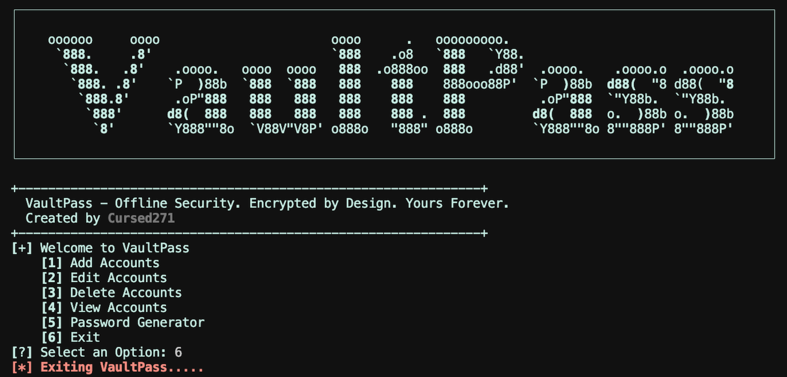
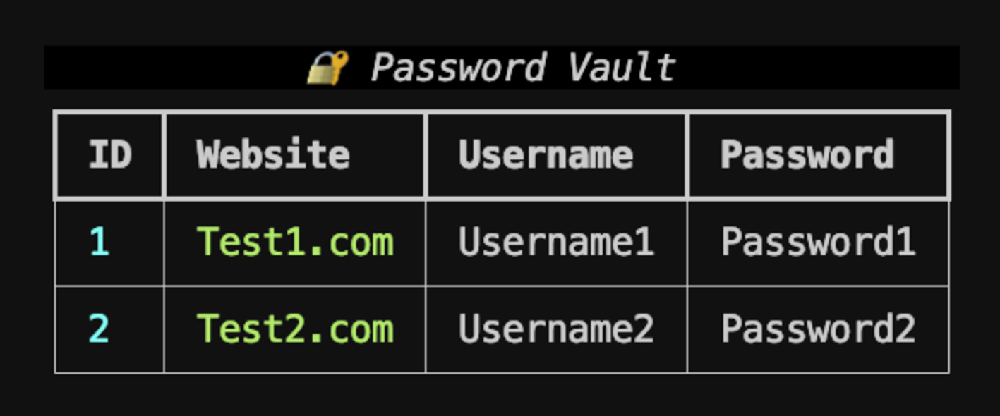

<div align="center">

  

  <h1>VaultPass</h1>

  <p align="center">
    
  </p>

  <p align="center">
    
    
    
    
    <a href="./LICENSE">
      
    </a>
  </p>

  <p>Your Passwords. Your Machine. Your Control.</p>

</div>


## Overview

VaultPass is a local, educational password manager built with Python, SQLite, Rich, and the `cryptography` library.

It stores website credentials in a local SQLite database, encrypts passwords with AES-CBC, protects access with a master password held through the operating-system keyring, and includes a configurable password generator.

> VaultPass is intended for learning, personal experimentation, and authorized security research. It is not positioned as a production-grade enterprise password manager.

## Features

| Capability | What it does |
| :--- | :--- |
| Local credential vault | Creates and uses `VaultPass.db` to store account records. |
| Master-password access | Uses the operating-system keyring to store and verify the VaultPass master password. |
| Key derivation | Derives a 256-bit encryption key from the master password using PBKDF2-HMAC-SHA256. |
| AES encryption | Encrypts account passwords using AES-CBC with a random initialization vector. |
| Account management | Add, edit, delete, and view website credentials. |
| Password generator | Creates randomized passwords with uppercase, lowercase, numeric, and symbol characters. |
| Terminal interface | Provides a Rich-based interactive menu and password-vault table. |

## Screenshots:

### Interface


### Output


## Security Model

| Component | Implementation |
| :--- | :--- |
| Master password | Stored through the system keyring under the `VaultPass` service. |
| Encryption key | Derived using PBKDF2-HMAC-SHA256 with 1,000,000 iterations. |
| Password storage | AES-CBC encryption with a random 16-byte IV. |
| Database | Local SQLite file named `VaultPass.db`. |
| Generator entropy | Uses Python's `secrets` module for random selection and shuffling. |

> The supplied implementation uses a hardcoded salt value. Treat the vault as an educational implementation rather than a hardened production credential store.

## Installation

### Prerequisites

- Python 3 with `pip`.
- A supported operating-system keyring backend.
- An interactive terminal.

Install the required packages:

```bash
python3 -m pip install rich pwinput keyring cryptography
```

If your environment uses `python` rather than `python3`, substitute that interpreter consistently.

## Usage

Run the application:

```bash
python3 VaultPass.py
```

On first launch, VaultPass prompts you to create a master password. That password is stored in the system keyring and is used to derive the AES encryption key.

### Main Menu

| Option | Action |
| :--- | :--- |
| `1` | Add a website, username, and password. |
| `2` | Edit an existing account by ID. |
| `3` | Delete an existing account by ID. |
| `4` | View all stored accounts and decrypted passwords. |
| `5` | Generate a password of at least 16 characters. |
| `6` | Exit VaultPass. |

### Password Generator

The generator enforces a minimum length of 16 characters and guarantees at least one uppercase letter, lowercase letter, digit, and symbol. Remaining characters are selected from the combined character set and shuffled securely.

## Data Storage

VaultPass creates the following local artifacts:

| File | Purpose |
| :--- | :--- |
| `VaultPass.db` | SQLite database containing account names, usernames, and encrypted passwords. |
| Operating-system keyring entry | Stores the VaultPass master password. |

Deleting the database does not necessarily remove the keyring entry. Remove the `VaultPass` keyring entry separately if you want to reset master-password access.

## Known Limitations

- The salt is hardcoded in the source.
- AES-CBC is used without an authentication tag; ciphertext integrity is not independently verified.
- Decrypted passwords are displayed in the terminal table.
- Account deletion removes the database row but does not securely erase prior database pages.
- The master-password comparison is performed in plaintext within the application.
- No export, import, backup, multi-user, or password-history functionality is implemented.
- No database migration or schema-version handling is provided.

## Safe Use

- Use a unique master password that is not reused elsewhere.
- Keep `VaultPass.db` and keyring access private.
- Do not use VaultPass for production credentials without independently reviewing its cryptography and threat model.
- Back up important credentials through a trusted and tested mechanism.
- Avoid running VaultPass on shared or untrusted systems.

## Version History

| Version | Scope |
| :--- | :--- |
| Version 1 | Local SQLite vault, AES-CBC password encryption, master-password access, account management, and password generation |


## License & Usage

VaultPass is distributed under the CursedSec Ownership Edict (COE).

Read [LICENSE](./LICENSE) for the applicable permissions, restrictions, contribution terms, and disclaimers. Public source availability is not a substitute for those terms.

## Feedback & Contributions

Use the repository's bug-report or feature-request template when issue submission is available.

Include the version, operating system, command, sanitized output, and reproduction steps. Never publish client scan results, credentials, sensitive infrastructure details, or evidence containing confidential data.

Check the security-reporting instructions before disclosing a vulnerability. Review the license and contribution terms before submitting modifications.

## Connect & Collaborate

<div align="center">

  <a href="https://github.com/Cursed271">
    
  </a>
  <a href="https://www.cursedsec.com/">
    
  </a>
  <a href="https://www.linkedin.com/in/cursed271/">
    
  </a>

  <p>Discover. Encrypt. Control.</p>
  <sub>CursedSec.com · Cursed271 · VaultPass</sub>

</div>


